<h1 align="center">RideLink</h1>
<hr>
<h3 align="center">Book. Ride. Arrive.</h3>
<h4 align="center">A ride-booking platform where riders can book rides and drivers can accept and manage them.</h4>

<p align="center">
  
  
  
  
  
</p>

<p align="center">
  
  
  
  
  
</p>

<p align="center">
  
  
</p>

---

## 📌 Project Overview

RideLink is a Java-based web application designed to simplify everyday city travel by connecting riders with drivers through a ride-booking platform.

The project uses JSP and Jakarta Servlets for web interactions, Core Java for business logic, JDBC for database connectivity, and MySQL for data storage. Maven is used to manage project dependencies.

## ✨ Features

### 👤 Rider Module
- Register and log in
- Enter pickup and destination locations
- Select a vehicle type
- View estimated fare
- Book or cancel rides
- View ride information and ride history
- Rate and review a driver

### 🚘 Driver Module
- Register and log in
- Register vehicle information
- Manage driver availability
- View ride requests
- Accept or reject ride requests
- Update ride status
- View ride history
- View earnings

### 💳 Fare and Payment
- Estimate fare based on trip distance and vehicle type
- Record payment information
- Support the payment options implemented in the application

> **Note:** A real payment gateway, production-grade live GPS tracking, and third-party map integration should be described as implemented features only after they have been configured and tested. Otherwise, keep them under Future Scope.

## 🛠️ Technologies Used

| Technology | Purpose |
|---|---|
| Java 17+ | Application and business logic |
| Jakarta Servlets | HTTP request handling |
| JSP | Dynamic web pages |
| JDBC | Database connectivity |
| MySQL 8.x | Relational database |
| HTML5 | Page structure |
| CSS3 | Styling and layout |
| JavaScript | Client-side interactions |
| Bootstrap | UI components, where used |
| Maven | Dependency management |
| Apache Tomcat 10.1 | Web application server |
| Eclipse IDE | Development environment |
| Git and GitHub | Version control and project hosting |

## 🏗️ Application Architecture

RideLink uses a layered structure to separate request handling, business rules, database access, and application data.

```text
                    RIDELINK
                       |
                       v
          Frontend: HTML, CSS, JavaScript
                       |
                       v
                  JSP Pages
                       |
                       v
              Controller Layer
           (Jakarta Servlets)
                       |
                       v
                Service Layer
             (Business Logic)
                       |
                       v
                  DAO Layer
            (Database Operations)
                       |
                       v
                      JDBC
                       |
                       v
                MySQL Database
```

### Layer Responsibilities
- **Controller:** Receives web requests and coordinates responses.
- **Service:** Implements application business rules and workflows.
- **DAO (Data Access Object):** Performs database operations.
- **Model:** Represents application data, such as users, drivers, vehicles, rides, payments, locations, and ratings.
- **Util:** Provides shared utilities, including database connection and validation helpers.
- **JSP:** Renders dynamic pages for the user interface.

## 📂 Project Folder Structure

The following structure reflects the folders and filenames documented for the project. If your current repository differs, update this tree to match the files actually committed.

```text
RideLink/
├── pom.xml
├── .gitignore
└── src/
    └── main/
        ├── java/
        │   └── com/
        │       └── ridelink/
        │           ├── controller/
        │           │   ├── AcceptRideServlet.java
        │           │   ├── DriverDashboardServlet.java
        │           │   ├── DriverEarningsServlet.java
        │           │   ├── DriverEntryServlet.java
        │           │   ├── DriverLocationServlet.java
        │           │   ├── DriverMatchingServlet.java
        │           │   ├── DriverRegisterServlet.java
        │           │   ├── DriverRideHistoryServlet.java
        │           │   ├── DriverRideServlet.java
        │           │   ├── DriverStatusServlet.java
        │           │   ├── LocationServlet.java
        │           │   ├── LoginServlet.java
        │           │   ├── LogoutServlet.java
        │           │   ├── PaymentServlet.java
        │           │   ├── RatingServlet.java
        │           │   ├── RegisterServlet.java
        │           │   ├── RideEstimateServlet.java
        │           │   ├── RiderDashboardServlet.java
        │           │   ├── RideServlet.java
        │           │   ├── RideStatusServlet.java
        │           │   ├── RideTrackerServlet.java
        │           │   ├── VehicleRegisterServlet.java
        │           │   └── VehicleServlet.java
        │           ├── dao/
        │           │   ├── DriverDAO.java
        │           │   ├── LocationDAO.java
        │           │   ├── PaymentDAO.java
        │           │   ├── RatingDAO.java
        │           │   ├── RideDAO.java
        │           │   ├── UserDAO.java
        │           │   └── VehicleDAO.java
        │           ├── model/
        │           │   ├── Driver.java
        │           │   ├── Location.java
        │           │   ├── Payment.java
        │           │   ├── Rating.java
        │           │   ├── Ride.java
        │           │   ├── User.java
        │           │   └── Vehicle.java
        │           ├── service/
        │           │   ├── DriverService.java
        │           │   ├── FareService.java
        │           │   ├── LocationService.java
        │           │   ├── MatchingService.java
        │           │   ├── PaymentService.java
        │           │   ├── RatingService.java
        │           │   ├── RideService.java
        │           │   ├── RideStatusService.java
        │           │   ├── UserService.java
        │           │   └── VehicleService.java
        │           └── util/
        │               ├── DBConnection.java
        │               ├── DBTest.java
        │               ├── DistanceCalculator.java
        │               └── ValidationUtil.java
        └── webapp/
            ├── index.jsp
            ├── login.jsp
            ├── register.jsp
            ├── css/
            │   └── style.css
            ├── js/
            │   ├── booking.js
            │   └── script.js
            ├── driver/
            │   ├── earnings.jsp
            │   ├── home.jsp
            │   ├── register.jsp
            │   ├── ride-history.jsp
            │   └── vehicle-register.jsp
            ├── rider/
            │   ├── booking.jsp
            │   ├── current-ride.jsp
            │   ├── dashboard.jsp
            │   ├── rating.jsp
            │   └── ride-tracker.jsp
            └── Payment/
                └── Payment.jsp
```

## 🔄 Project Workflow

```text
                         RIDELINK
              Smart Ride Booking Platform
                           |
                           v
                  User Registration
                           |
                           v
                       User Login
                           |
                           v
               Enter Pickup and Destination
                           |
                           v
                   Select Vehicle Type
                           |
                           v
                    Estimate Ride Fare
                           |
                           v
                      Book a Ride
                           |
                           v
                 Find Suitable Available Driver
                           |
                           v
                 Driver Accepts the Request
                           |
                           v
                    Ride Status Updates
                           |
                           v
                       Complete Ride
                           |
                           v
                    Process/Record Payment
                           |
                           v
                    Rate and Review Driver
                           |
                           v
                       View Ride History
```

**Workflow note:** Driver matching, ride status changes, payment behavior, and tracking should reflect what is currently working in the application. Features not yet implemented should be listed under Future Scope.

## 💰 Fare Calculation

RideLink uses a distance-based fare estimate. The project documentation lists these example vehicle rates:

| Vehicle Type | Rate |
|---|---:|
| Bike | ₹10/km |
| Auto | ₹15/km |
| Car | ₹20/km |

The estimated fare is calculated using the trip distance and the selected vehicle's rate. Confirm that these rates match the values in the current source code before presenting them as final.

## 🗄️ Database Setup

RideLink uses MySQL for application data. The database may include entities for users, drivers, vehicles, rides, payments, locations, and ratings, depending on the current schema.

1. Start your MySQL server.
2. Create the database using the name configured in your application.
3. Create the required tables using your project's SQL schema.
4. Configure the JDBC URL, username, and password in `DBConnection.java`.
5. Keep database credentials private; do not commit passwords or secrets to GitHub.

## 🚀 Installation and Setup

### Prerequisites
- Java JDK compatible with the project configuration
- Eclipse IDE for Enterprise Java and Web Developers
- Apache Tomcat 10.1
- MySQL Server
- Maven

### 1. Clone the Repository

```bash
git clone https://github.com/Vanshika-ramoshi/RideLink.git
```

### 2. Import the Project into Eclipse
1. Open Eclipse.
2. Select **File → Import**.
3. Choose **Maven → Existing Maven Projects**.
4. Select the cloned `RideLink` directory.
5. Finish the import.

### 3. Configure the Database
1. Start MySQL.
2. Create the database and required tables.
3. Set the JDBC URL, database username, and password in `DBConnection.java`.
4. Verify the connection using the project's database test utility, if applicable.

### 4. Update Maven Dependencies
Right-click the project and select **Maven → Update Project**.

### 5. Run on Tomcat
1. Configure Apache Tomcat 10.1 in Eclipse.
2. Add RideLink to the server.
3. Start the server.
4. Open the application at the local URL and context path assigned by Eclipse/Tomcat.

> The database name, schema, and application context path depend on your local configuration.

## 📸 Project Screenshots

Explore the RideLink Smart Ride Booking Platform through the screenshots below.

---

<div align="center">

## 🔐 Authentication

<table>
<tr>
<td align="center"><strong>User Registration</strong></td>
<td align="center"><strong>Login</strong></td>
</tr>
<tr>
<td>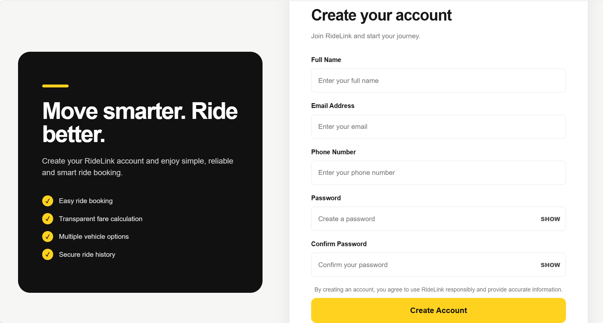</td>
<td>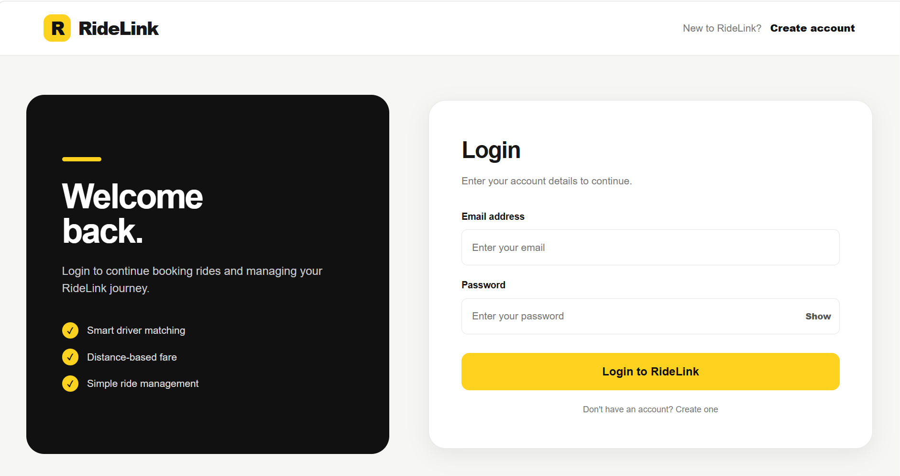</td>
</tr>
</table>

<p><em>User authentication and registration for accessing RideLink services.</em></p>

</div>

---

<div align="center">

## 🏠 Home Page

<table>
<tr>
<td align="center"><strong>Home Page 1</strong></td>
<td align="center"><strong>Home Page 2</strong></td>
</tr>
<tr>
<td>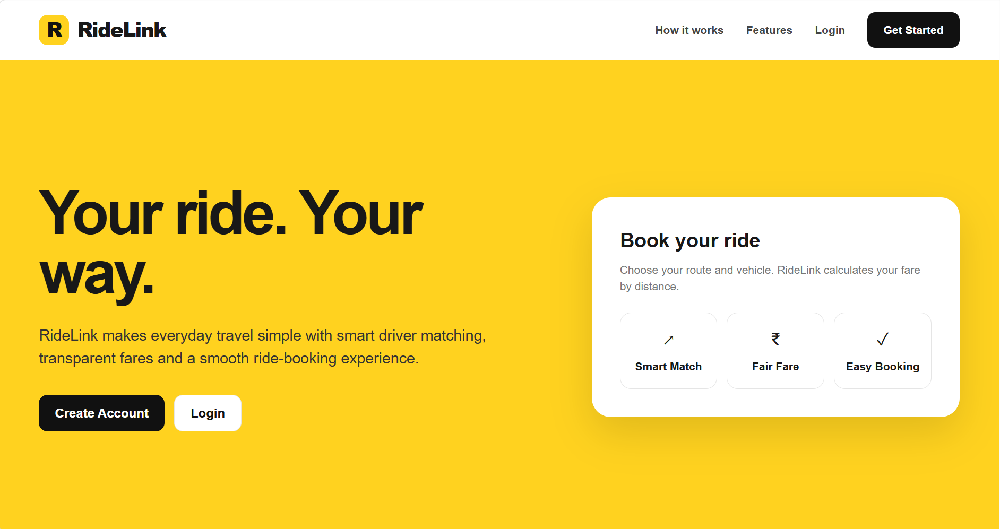</td>
<td>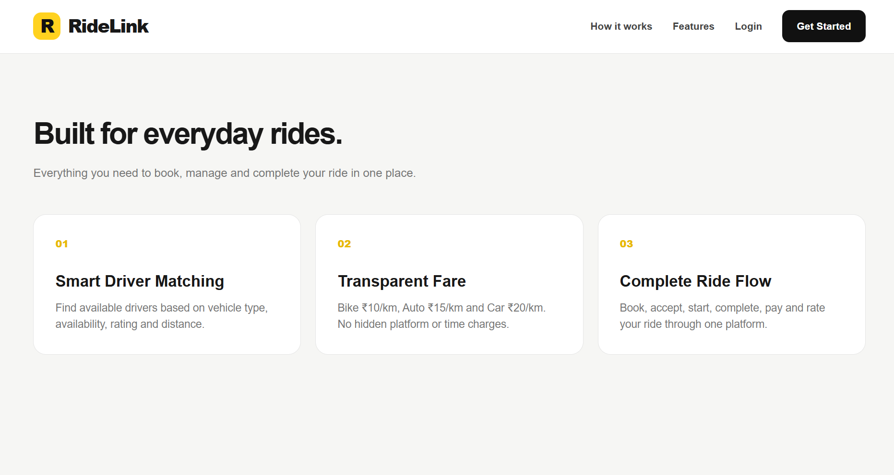</td>
</tr>
<tr>
<td align="center"><strong>Home Page 3</strong></td>
</tr>
<tr>
<td>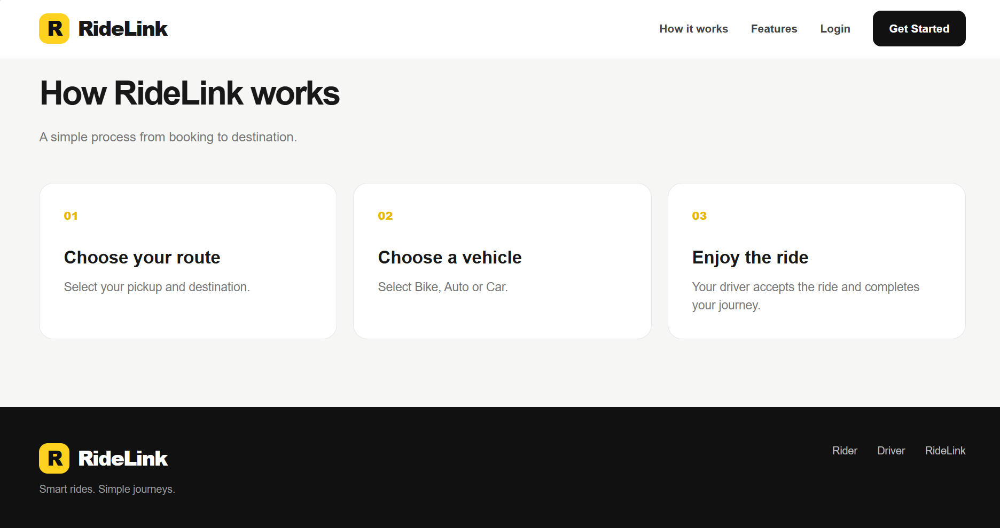</td>
</tr>
</table>

<p><em>Explore the RideLink platform and access the ride booking system.</em></p>

</div>

---

<div align="center">

## 🚗 Rider Dashboard

<table>
<tr>
<td align="center"><strong>Dashboard 1</strong></td>
<td align="center"><strong>Dashboard 2</strong></td>
</tr>
<tr>
<td>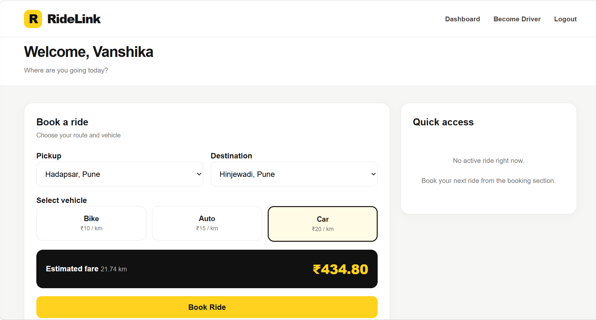</td>
<td>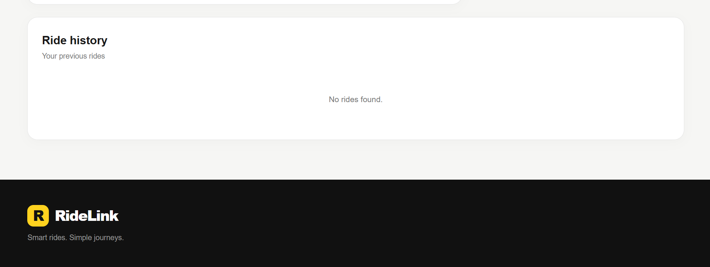</td>
</tr>
<tr>
<td align="center"><strong>Dashboard 3</strong></td>
<td align="center"><strong>Dashboard 4</strong></td>
</tr>
<tr>
<td>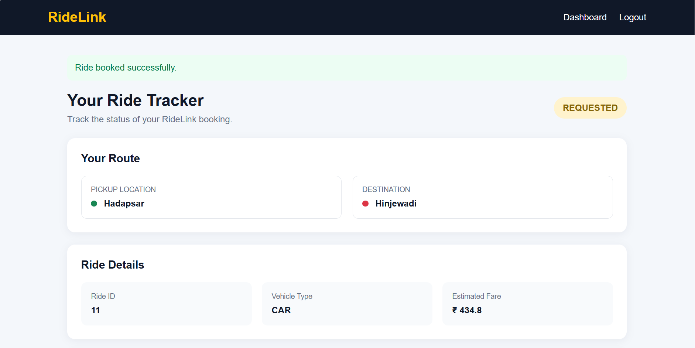</td>
<td>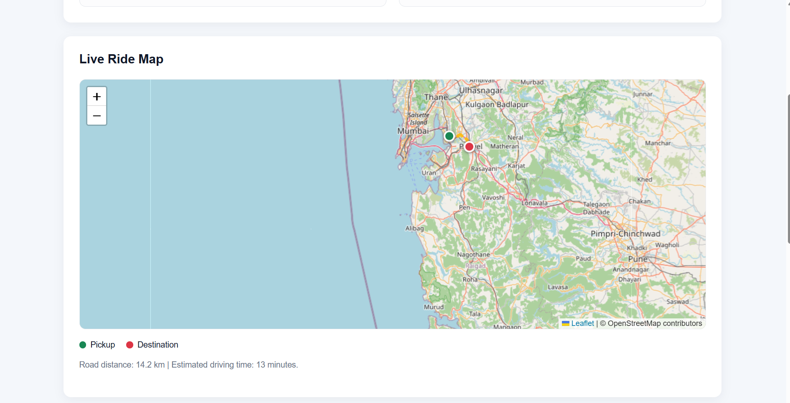</td>
</tr>
<tr>
<td align="center"><strong>Dashboard 5</strong></td>
<td align="center"><strong>Dashboard 6</strong></td>
</tr>
<tr>
<td>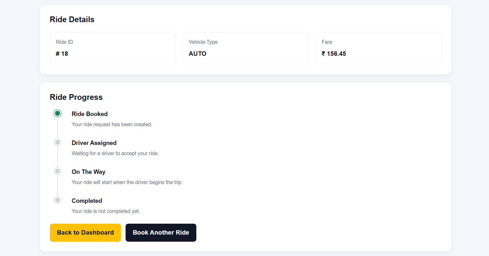</td>
<td>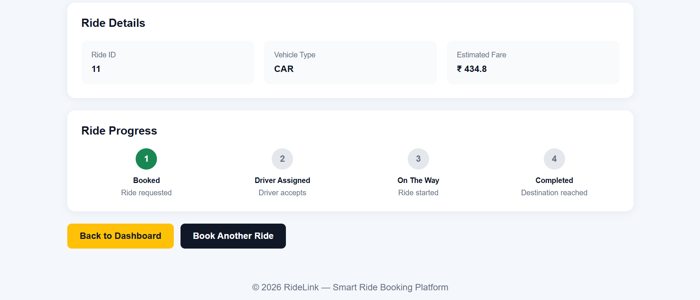</td>
</tr>
</table>

<p><em>Book rides, view ride information, and access rider features through the dashboard.</em></p>

</div>

---

<div align="center">

## 🚘 Driver Dashboard

<table>
<tr>
<td align="center"><strong>Driver Dashboard 1</strong></td>
<td align="center"><strong>Driver Dashboard 2</strong></td>
</tr>
<tr>
<td>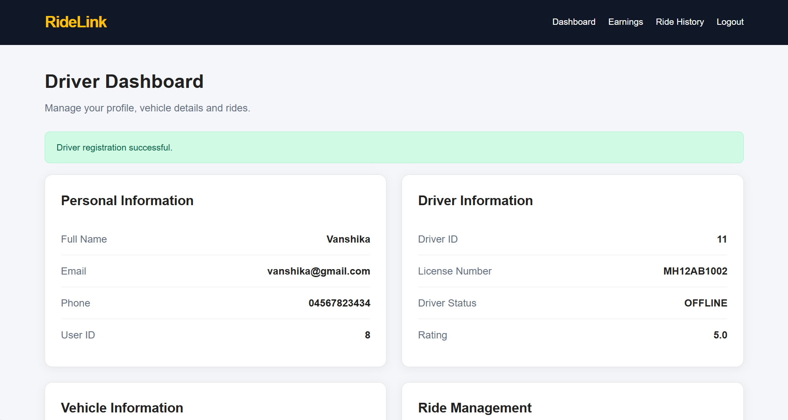</td>
<td>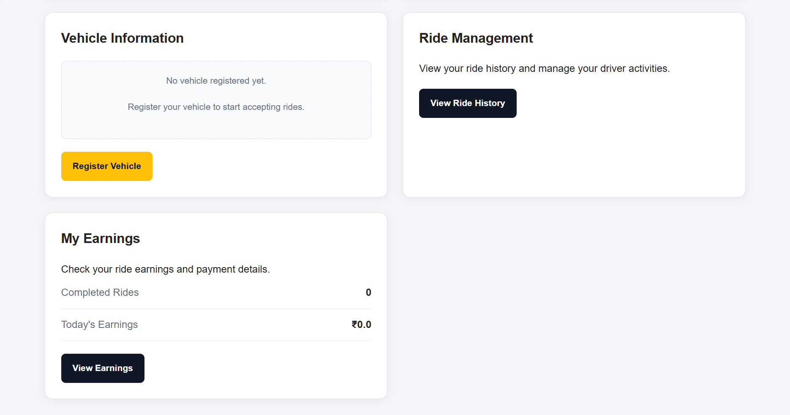</td>
</tr>
</table>

<p><em>Driver dashboard for managing rides and accessing driver-related features.</em></p>

</div>

---

<div align="center">

## 💰 Driver Earnings

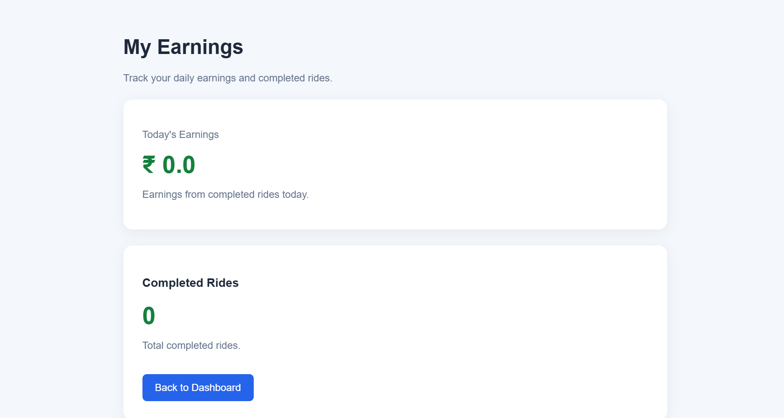

<p><em>View earnings and access driver earning information.</em></p>

</div>

---

<div align="center">

## 📋 Ride History

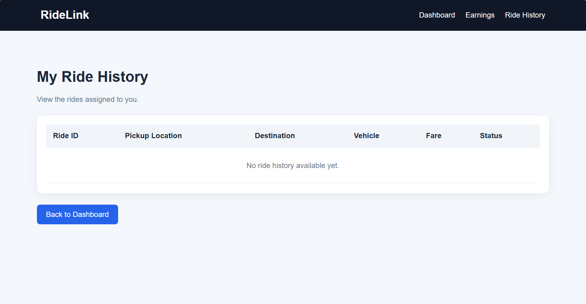

<p><em>Review ride history and previously booked rides.</em></p>

</div>

---

<div align="center">

## 🚙 Vehicle Registration

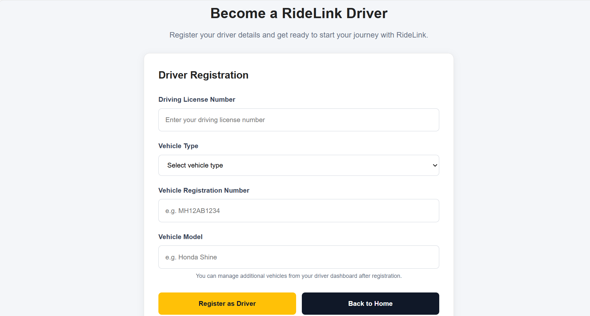

<p><em>Register vehicle details to support driver and vehicle management.</em></p>

</div>

---


## 🔮 Future Scope

- **Real-time GPS tracking:** Integrate a mapping service to show a driver's location and ride progress on a map.
- **Real payment gateway:** Add a payment provider for secure digital payments instead of simulated payment processing.
- **Notifications:** Send booking confirmations and ride-status updates to riders and drivers.
- **Ride scheduling:** Allow riders to reserve rides for a future date and time.
- **Smarter driver matching:** Improve matching using distance, availability, vehicle type, and estimated arrival time.
- **Dynamic fare calculation:** Consider traffic, demand, trip distance, and vehicle category when estimating fares.
- **Admin dashboard:** Provide tools to manage accounts, vehicles, rides, payments, and reports.
- **Security improvements:** Add password hashing, role-based authorization, input validation, and secure session handling.
- **Analytics and reporting:** Summarize ride activity, earnings, and driver performance.
- **Mobile application:** Extend the platform with an Android app.

## 🎯 Learning Outcomes

This project provides practical experience with:
- Java web application development
- JSP and Jakarta Servlet request handling
- JDBC and MySQL database connectivity
- DAO and Service Layer separation
- Maven dependency management
- Layered application architecture
- Git and GitHub version control

# 👩‍💻 Author

<div align="center">

## Vanshika Ramoshi

**Bachelor of Computer Applications Graduate**

Java Full Stack Developer • Web Development • Database Applications

Building practical web applications using Java, JDBC, Servlets, JSP, and MySQL.

<br>

<a href="https://github.com/Vanshika-ramoshi">

</a>

<a href="https://www.linkedin.com/in/vanshika-ramoshi-tech">

</a>

</div>

---

<div align="center">

## 🚗 RideLink

### Smart Ride Booking Platform

**Book rides effortlessly.**
**Connect riders and drivers.**
**Experience smarter mobility.**

</div>

